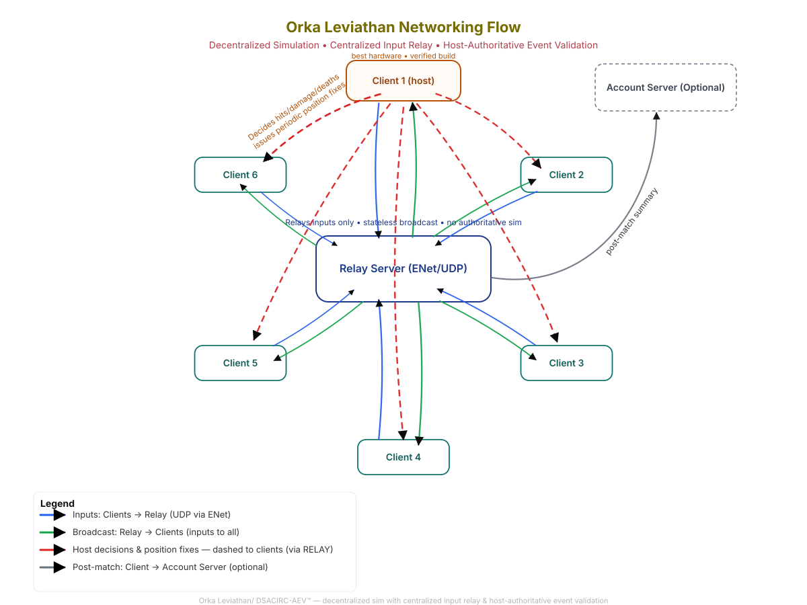

## Orka Multiplayer netcode
Orka provides a fairly low-level networking subsystem built on ENet (UDP) because playing alone is boring, but writing network code is even worse... 
You should know this already.
Built on top of that system, Orka also provides an own netcode model!
That model mixes several existing approaches and adds own creativity. Don't believe me? Well...
#### Technically, it's a DSACIRC-AEV™ ("decentralized simulation architecture with centralized input relaying and (host-)client-authoritative event validation" - yeah I know...) ™ is purely for fun, because acronyms always make things sound more serious than they really are...
#### ... but because that name sounds like a military refrigerator we call it... 

# ***Leviathan***

Enough acronyms, here is what it actually DOES:
- Every client renders its game and sends its "inputs" (rotation, lookdir, movedir etc) to the relay server
- The relay server broadcasts the received data to all clients participating the match
- Each client then **simulates itself and the other players independently** based on these inputs — with no need for a dedicated authoritative server!
- But: There is one special client - **the host** - which is a **regular participant**, with the **best hardware** (determined by **HardwareJudger**) and in the best case verified build/data directory to prevent cheating
- The host is a regular participant but has one **extra job**: it **decides critical events** (hit, damage, death, ...) and sends **position updates** to the other clients periodically.
- optional: After the match, every client sends its summary of the game (e.g. each players kills/deaths/...) to the account server that compares the received summaries to detect cheats and saves the correct one (e.g. for ranking/shop currencies)

#### Cheating aspects
Clients are *theoretically* free to cheat locally (e.g. infinite HP, flying, speedhacks), but:
- Only the host's version of reality counts.
  - Host says "you're dead"? → You're dead. No matter how much HP you think you have.
  - Host says "you're at position X"? → You're at position X. Your teleport hack just desynced you.
  - The host's corrections overwrite all local divergences on every client, silently and regularly.
  - And if you just ignore the host corrections? Good luck! You are now officially disconnected from reality! The cheat still stays local so you will have a big disadvantage...

- A cheating host can be detected if multiple clients teleport or die early.
- A modified game summary will be detected by the account server and another one is used!

> Cheating disconnects you from reality, not from the game! - Old wise speech from aah... me

- There is no invasive anti-cheat because most client-side cheats have little or no lasting global effect... Unless the host is compromised...
- Cheaters only deceive themselves; the rest of the game simply ignores them.
- This creates a natural deterrent: cheating is technically allowed, but functionally pointless.

- Although that's enough in almost all cases, the Leviathan protocol uses encryption or hash based verification depending on the used device
### With this setup, it's possible to enjoy smooth gameplay without requiring 100% correct but only visual determinism! Cheating is not punished actively — it's literally ignored!

#### Limitations
- Leviathan scales best with around 4-30 players. Do not try to add more unless you want to melt the host...
- The anti-cheat might be fine for most purposes but might not be enough for important matches
- Currently only one host is supported
- You currently can't join already running matches

If you want to use another networking approach, feel free. No one forces you into one approach!