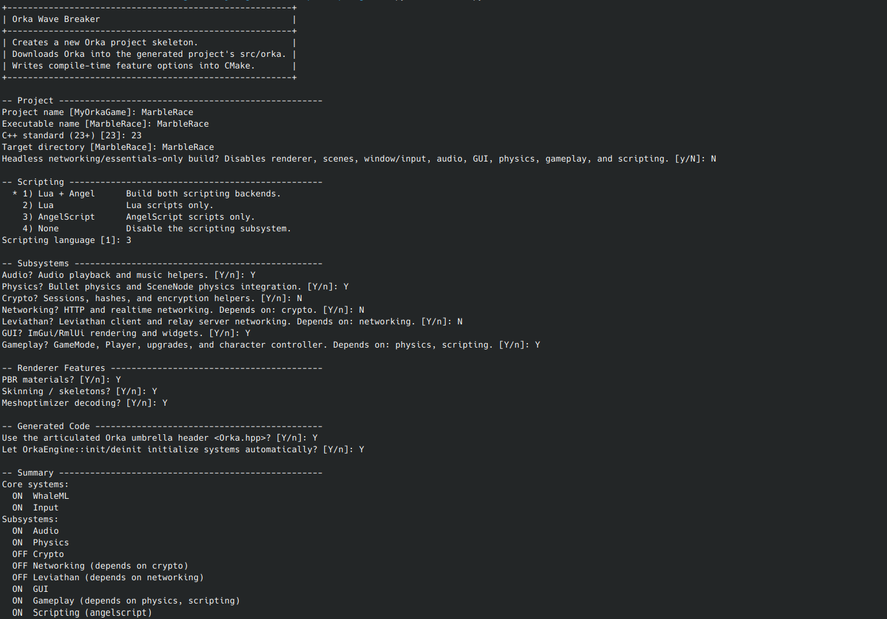
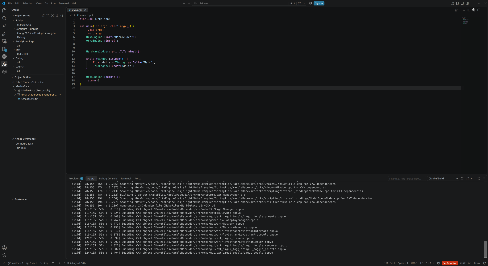
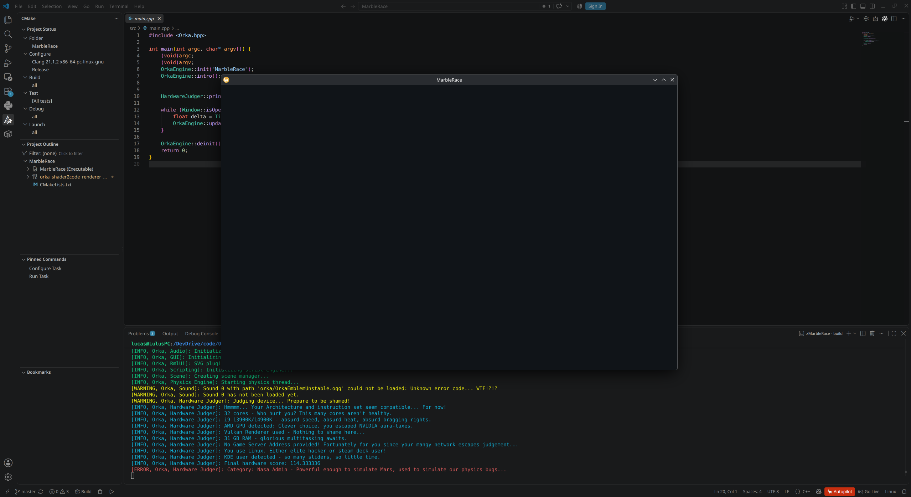
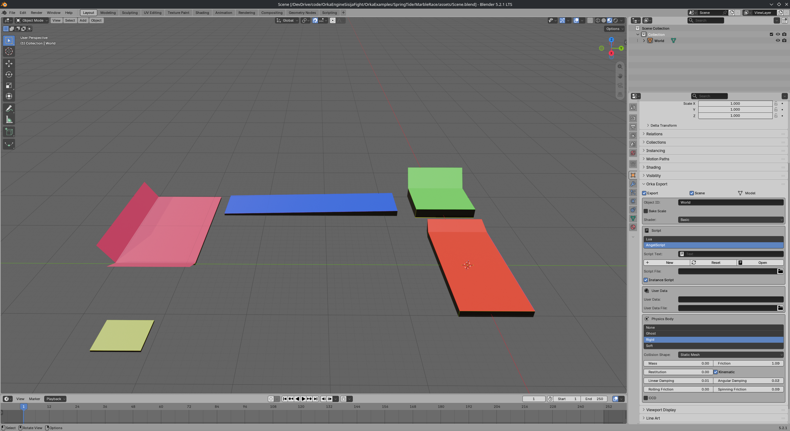
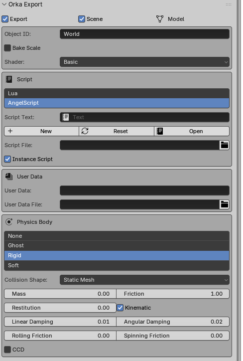
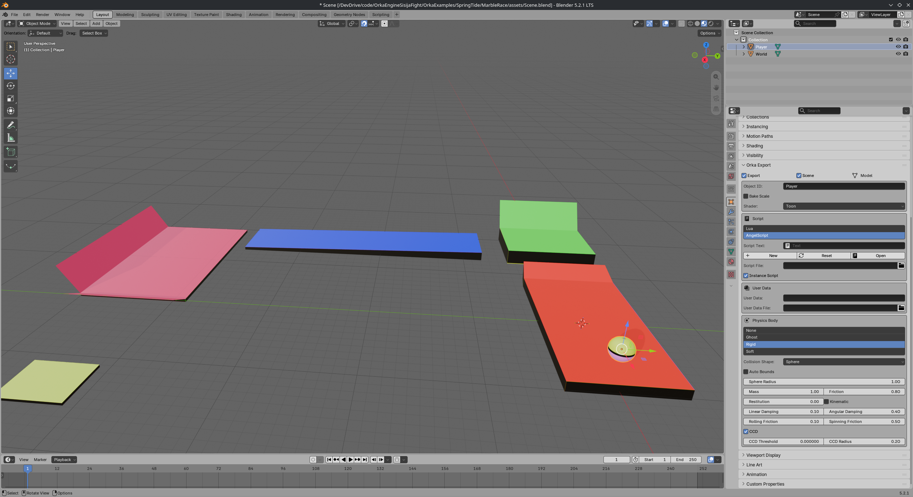
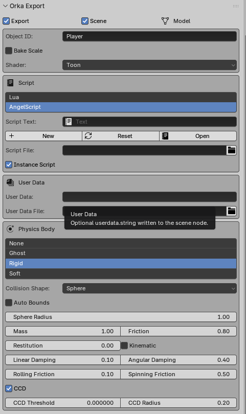
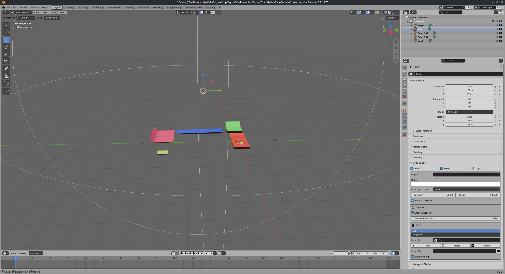
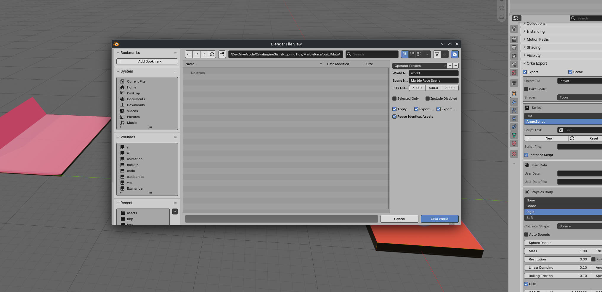
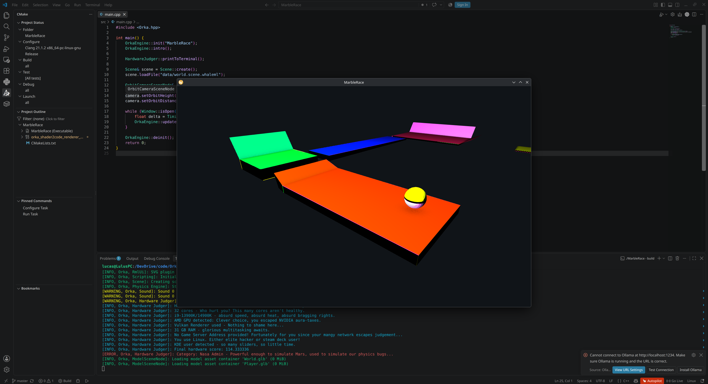

## Here is a small tutorial
...to introduce you to Orka's major subsystems

To do so, we will create a little game.
I thought about something ridiculously simple, like a marble race. A simple world consisting of primitive shapes and a player made of a ball. You control the ball over obstacles and physics does the rest. Maybe we could also add some power ups etc. 
This little demo will require:
- Scene System (obviously)
- Physics
- Input
- GameMode
- maybe CharacterController for some advanced character stuff
- Audio

First, you have to create a new Orka project. Do so by using the wizard script. It will ask you some stuff. You may use the options I selected (on the screenshot here)


For the remaining options just press enter (for the default value). It will then download Orka, create a project skeleton and install all dependencies.

Installation is now done 🥳

--- 
You now have 2 options to write code. 
1. Manually edit the files and use the *build.sh/bat* to build the executable
Or
2. Use an IDE like VSCode to open the project folder (the one that was created by *wizard.py*)
I absolutely recommend option 2

Now open *src/main.cpp*. You should see a basic Orka-application skeleton. If you now hit compile (or use *build.bat/sh* accordingly) 

The compiler will do its job and compile Orka with all your selected subsystems and the current application-skeleton-thing.

Launch the Application in *build/MarbleRace(.exe)* and you will see this:

An empty window and a basic Orka startup log (of course including HardwareJudger comments 😁)

We can now continue with the actual gameplay

---

Install [Blender](https://blender.org) and the [Orka Blender Export addon](https://springtechstudios.cloudns.org/SpringTechStudios/OrkaBlenderExporter)

Open it and create a basic "obstacle course" level like this:

Configure the World node:

It is important to set...
- ...the mass to 0 (the Physics Engine will then interpret it as static)
- …the collision shape to *Static Mesh*
- …the shader to *Basic* (because we want basic diffuse lighting)
- …the object ID to *World*

Now add a sphere as player and place it on your desired starting position

Configure the Player node:

We…
- …set the shape to *Sphere* and its radius to 1
- …set the mass to 1
- …enable some damping and friction to avoid endless spin
- …enable CCD
- …select Toon shader (because it looks nice)
- …set ID to *Player*

Finally, add some light:

Make sure the range and intensity fit the world

Now export all that shit to *MarbleRace/build/data* (*build* should contain your application):


*data* should now contain the exported Scene (*models physics scenenodes scripts world.scene.whaleml*)

Your assets are now ready to start coding 😎

---
You probably just want to see something on screen… We could display the Scene on screen and move a camera around it

Replace the skeleton-application with this:
```cpp
#include <Orka.hpp>

int main() {
    OrkaEngine::init("MarbleRace");
    OrkaEngine::intro();

    HardwareJudger::printToTerminal();

    Scene& scene = Scene::create();
    scene.loadFile("data/world.scene.whaleml"); // Loads the scene we just exported

    OrbitCameraSceneNode& camera = OrbitCameraSceneNode::create();
    camera.setOrbitObject(0); // We follow the first Scene object for simplicity
    camera.setOrbitHeight(10); // We fly a bit above the Scene to see something
    camera.setOrbitDistance(20);

    while (Window::isOpen()) {
        float delta = Timing::getDelta("Main");
        OrkaEngine::update(delta);
    }

    OrkaEngine::deinit();

    return 0;
}
```
This is the result:


To demonstrate some Physics, just add this line
```cpp
PhysicsEngine::applyCentralImpulse(1, vector3df(-20, 0, 0));
```
after the camera stuff. The ball will be accelerated in the negative X direction and interact with the world 🥳

We use the bare identifiers of the objects here because we know 0 = World and 1 = Player. Later, or if you don't know the exact ID of the object, you can use
```cpp
std::vector<Identifier> playerNodes = SceneManager::getSceneNodesWhere([](const SceneNode& node) { return node.getName() == "Player"; });
```
for example.


Let's add some real game logic.
```cpp
#include <Orka.hpp>

class MarbleRace : public GameMode { // Create a custom game mode
public:
    void load() {
        // Load the Scene
        Scene& scene = Scene::create();
        scene.loadFile("data/world.scene.whaleml");
        m_scene = scene;

        // Find nodes
        std::vector<Identifier> playerNodes = SceneManager::getSceneNodesWhere([](const SceneNode& node) { return node.getName() == "Player"; });
        std::vector<Identifier> worldNodes = SceneManager::getSceneNodesWhere([](const SceneNode& node) { return node.getName() == "World"; });
        if(playerNodes.empty() || worldNodes.empty()) {
            Logger::log(LET_CRITICAL_ERROR, "Marble Race, init", "The scene must contain at least a 'Player' node and a 'World' node!");
            exit(1);
        }
        m_playerNode = playerNodes[0];
        m_worldNode = worldNodes[0];

        // Add a third-person camera
        ThirdPersonCameraSceneNode& camera = ThirdPersonCameraSceneNode::create();
        camera.setFollowObject(m_playerNode); // The camera should follow the player
        camera.setCollisionEnabled(true); // The camera should not clip through walls
        camera.setFollowDistance(8);
        camera.setXAngle(degrees(20));
    }

    void update(float delta) {
        vector3df impulse(0);
        if(InputHandler::isPressed('w')) {
            impulse += vector3df(0, 0, 1); // Forward (z+)
        }
        if(InputHandler::isPressed('s')) {
            impulse += vector3df(0, 0, -1); // Backward (z-)
        }
        if(InputHandler::isPressed('a')) {
            impulse += vector3df(-1, 0, 0); // Left (x-)
        }
        if(InputHandler::isPressed('d')) {
            impulse += vector3df(1, 0, 0); // Right (x+)
        }
        if(InputHandler::isPressed(' ')) {
            impulse += vector3df(0, 12, 0); // Jump (y+)
        }

        if(PhysicsEngine::areColliding(m_playerNode, m_worldNode)) // Only apply impulses if on ground
            PhysicsEngine::applyCentralImpulse(m_playerNode, impulse * (delta * 100)); // Make it frame rate independent

        auto& player = SceneManager::getSceneNode(m_playerNode);
        if(player.getPosition().y < -10) { // If the player falls of the world...
            SceneManager::getScene(m_scene).destroy(); // destroy the Scene...
            load(); // ...and reload it again. I know this is very dirty but it works because Orka doesn't immediately destroy all SceneNodes (see 3D.md)
        }
    }

    void unload() {}

private:
    Identifier m_playerNode;
    Identifier m_worldNode;
    Identifier m_scene;
};

int main() {
    OrkaEngine::init("MarbleRace");
    OrkaEngine::intro();

    HardwareJudger::printToTerminal();

    GameplayManager::setGameMode<MarbleRace>();

    while (Window::isOpen()) {
        float delta = Timing::getDelta("Main");
        OrkaEngine::update(delta);
    }

    OrkaEngine::deinit();
    return 0;
}

```
This one is already playable... But as you can see, the camera has a fixed direction. Let's fix that.

Imagine we could make the camera move around the player (over the Y axis) and the player changing its movement-direction based on the look-direction.
To do this we could:
- Rotate the camera on mouse input
- Transform/rotate the velocity manually on camera movement